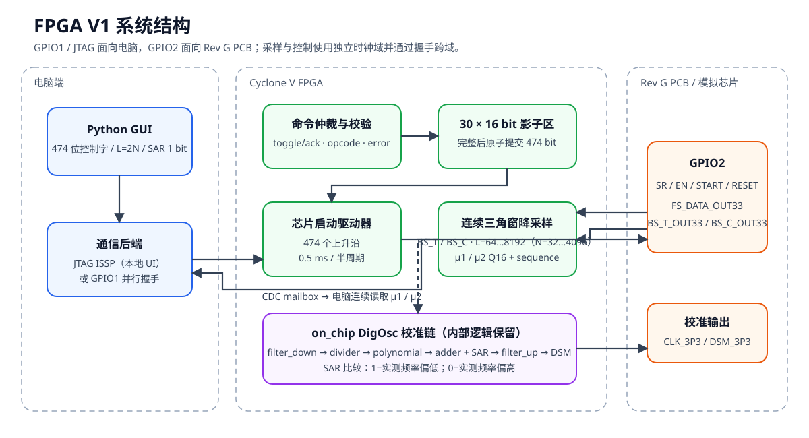
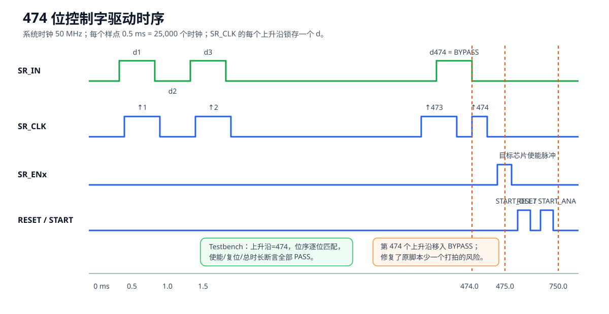
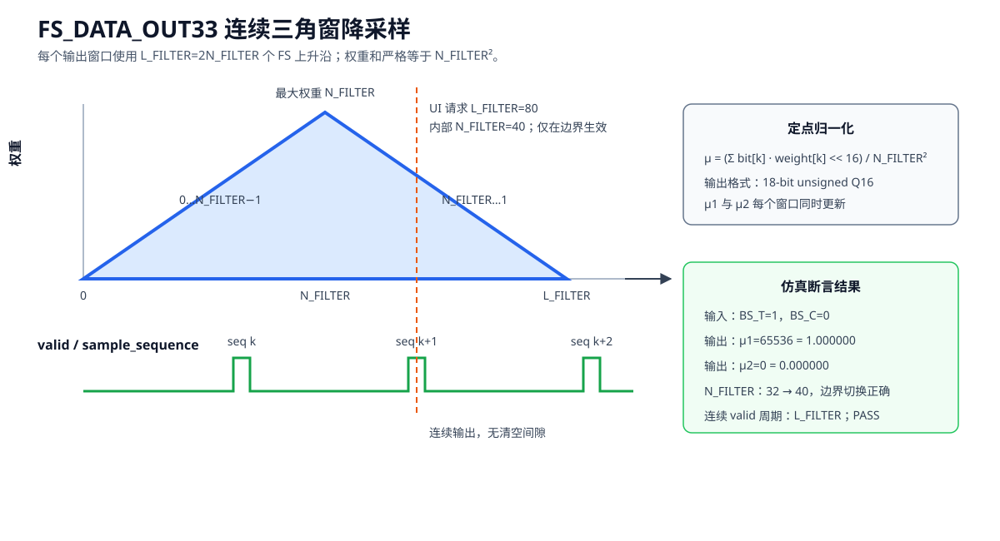

# FPGA V1：晶振芯片控制、连续采样与 SAR 校准

本目录是 Rev G PCB 的第一版可综合工程。它在 DE1-SoC Cyclone V
`5CSEMA5F31C6` 上实现以下闭环基础：

- 电脑端 GUI 结构化输入 474 位芯片控制字；
- 完全复现 MATLAB `drive.m` 的反转位序和 0.5 ms 半周期驱动；
- 修正 `CLK_SHReg`，严格产生 474 个上升沿，使最后的 `BYPASS` 被锁存；
- 直接集成 `Digital_Scripts_On_Chip` 的 DigOsc 校准链，并使用单个外部比较位推进 SAR；
- 以 `FS_DATA_OUT33` 为采样时钟，对 `BS_T_OUT33`、`BS_C_OUT33`
  做可在线调整窗口长度的连续三角窗降采样，默认每次输出使用 2048 个样点；
- 同时提供 JTAG ISSP 本地 UI 通道和 GPIO1 并行握手接口；
- 工程内路径全部相对于 `FPGA_V1` 自身解析，可整体复制到另一台电脑；
- 不包含 SignalTap。



## 1. 复制到新电脑后使用

请复制完整的 `FPGA_V1` 文件夹，不要只复制 `host` 或 `quartus` 子目录。
工程不依赖当前电脑的用户名、盘符、OneDrive 目录或固定的软件安装位置：

- PowerShell 以脚本自身的 `$PSScriptRoot` 定位工程；
- Python 以 `Path(__file__)` 定位 Tcl 和工程内的 `.sof`；
- QSF 中的 RTL 路径相对于 `quartus/fpga_v1.qsf`；
- Quartus/Questa 的临时数据库放在 Windows 临时目录，生成结果再复制回
  `quartus/output_files`；
- 构建期间自动用一个空闲临时盘符映射该临时目录，结束后解除映射，规避
  Quartus 25.1错误删除`AppData`等隐藏路径段及无法处理中文绝对路径的问题；
- Quartus 25.1 对中文绝对路径中的 Tcl 脚本兼容性不稳定，因此 JTAG
  子进程切换到 `host` 后只传 Tcl 文件名；加载时还会把 `.sof` 暂存到
  纯 ASCII 临时路径。

新电脑需要自行安装以下外部软件，它们不随工程复制：

1. Windows 10/11 和 PowerShell；
2. Python 3.10 或更高版本；当前 GUI 只使用 Python 标准库，无需 `pip install`；
3. Quartus Prime Lite 25.1std（含 Cyclone V 支持）和 USB-Blaster 驱动；
4. 只有运行 RTL 仿真时才需要 Questa FPGA Starter Edition。

工具发现优先级如下：

1. 推荐从 **Quartus Prime Command Prompt** 打开 PowerShell，使
   `quartus_sh.exe`、`quartus_stp.exe` 等已经位于 `PATH`；
2. 普通 PowerShell 中也可把 Quartus 的 `bin64` 加入 `PATH`，或把
   `QUARTUS_ROOTDIR` 设置为包含 `bin64` 的 Quartus 根目录；
3. 仿真工具可加入 `PATH`，或通过 `QUESTA_FSE_ROOT` / `QUESTA_ROOT`
   指定 Questa 根目录；
4. Python 启动脚本自动查找 `python.exe`，找不到时再使用 `py.exe -3`。

复制完成后，在新电脑的 `FPGA_V1` 根目录依次执行：

```powershell
# 可选：验证RTL；需要Questa
powershell -ExecutionPolicy Bypass -File .\scripts\simulate.ps1

# 首次使用或RTL改变后编译；需要Quartus
powershell -ExecutionPolicy Bypass -File .\scripts\build.ps1

# 启动中文GUI；JTAG操作需要Quartus和USB-Blaster驱动
powershell -ExecutionPolicy Bypass -File .\scripts\run_gui.ps1
```

如果随工程复制的 `quartus/output_files/fpga_v1.sof` 与当前源码一致，可直接
启动 GUI 并加载它；否则先运行构建脚本。GUI 启动后先点击“检查连接”：
`64-bit/64-bit` 表示 V1 镜像已就绪，`12-bit/12-bit` 表示 FPGA 中仍是
旧 LED demo，需要在确认 PCB 电气安全后点击“加载 FPGA V1 SOF”。

## 2. 当前硬件接口

GPIO2 直接连接 Rev G PCB，完整封装管脚映射在
`quartus/fpga_v1.qsf` 和
[PCB/GPIO端口_RevG_FPGA补充.xlsx](../PCB/GPIO端口_RevG_FPGA补充.xlsx)
中。

| 类别 | 方向 | 信号 |
|---|---|---|
| 芯片配置 | PC → FPGA → PCB | `Address[3:1]`、`SR_CLK`、`SR_IN`、`SR_EN[1:5]`、`RESET`、`START_DLL`、`START_ANA` |
| 数字采样 | PCB → FPGA → PC | `FS_DATA_OUT33`、`BS_T_OUT33`、`BS_C_OUT33` |
| 校准驱动 | FPGA → PCB | `CLK_3P3`、`DSM_3P3` |
| 预留输入 | PCB → FPGA | `OSC_OUT33_TO_FPGA`，V1 暂不参与算法 |
| SAR 判决 | PC → FPGA | 单 bit 命令；`1` 表示实测频率偏低，`0` 表示实测频率偏高 |

GPIO1 是可选的物理电脑接口：`PC_DATA[15:0]`、6 位索引、4 位操作码、
请求翻转位、读写位及状态返回。实际本地 GUI 默认通过板载 USB-Blaster 的
JTAG ISSP 通信，因此无需额外 USB-GPIO 适配器即可开始联调。

## 3. 474 位驱动与启动

`host/control_word.py` 按 MATLAB 原字段顺序先产生 474 位
`logical_bits`，再执行与 `flip(Din_data)` 相同的反转。反转后的
`serial_bits[0]` 是第一个送入 `SR_IN` 的 `d1`；FPGA 用 30 个
16-bit 传输字暂存，共 480 bit，只有收到全部 30 个块后才允许原子提交。
最高 6 个填充位不送往芯片。



每次启动事务固定经历：

1. 0.5 ms 前置空闲；
2. 474 个数据位，每位低、高手各 0.5 ms；
3. 移位后空闲及目标 `SR_ENx` 脉冲；
4. 3.5 ms 防护间隔；
5. `RESET`、`START_DLL`、`START_ANA`；
6. 保持安全电平直到总事务长度 750 ms。

`broadcast=1` 时五路 `SR_EN` 同时有效；否则由芯片号 0…4 选择。

### 3.1 GUI 直接输入定长二进制码字

第一版 GUI 不再要求用户进行十六进制或十进制转换。所有多 bit 控制字段
均直接输入由 `0`、`1` 组成的定长二进制串：

| 字段 | 必须输入的位数 | 合法示例 |
|---|---:|---|
| `CS` | 2 | `10` |
| `TRIM_C_COARSE` | 3 | `101` |
| `TRIM_C_FINE` | 3 | `011` |
| `TRIM_R_XO` | 4 | `1011` |
| `ALPHA` | 18 | `010000000000000000`，即Q16的1.0 |
| 每个Batch系数 | 29 | 29个连续的0/1 |
| 每个Polynomial系数 | 29 | 29个连续的0/1 |

输入框允许首尾空白，但去除首尾空白后必须恰好等于字段位宽；不接受
`0x`前缀、下划线、空格、小数点或其他字符。29-bit signed Q16负数应直接
输入其29-bit二进制补码位型，不在GUI内输入负号或小数。

当前大部分字段默认显示全0，是因为尚未获得一套可确认安全且正确的实际
芯片TRIM、Batch和Polynomial配置。全0只是占位码字，不代表推荐校准参数。
`ALPHA`默认显示`010000000000000000`，对应Q16的1.0。正式上板前应载入
经确认的JSON配置，并逐项检查专有字段。复选框字段继续直接用勾选/未勾选
表示1/0。

Python批量测试API内部仍使用整数保存字段，以便进行474位拼接；这是程序
内部表示，不改变GUI“直接输入原始二进制码字”的规则。载入旧JSON时，
GUI会按各字段位宽自动恢复为带前导零的二进制串。

## 4. 连续三角窗 μ1 / μ2，以及两个 N 的区别

V1 的可调降采样器位于 `rtl/triangular_decimator_runtime.sv`。
它和片内降采样使用同一类长度为 `2N_FILTER` 的三角窗：

```text
weight = 0, 1, ..., N_FILTER-1, N_FILTER, N_FILTER-1, ..., 1
sum(weight) = N_FILTER²
μ = sum(bit × weight) / N_FILTER²
```

本项目历史讨论中曾把两个不同概念都写作 `N`，现在统一区分：

| 名称 | 默认值 | 含义 | 所属流程 |
|---|---:|---|---|
| `N_DAQ` | 1500 | 原 MATLAB/LabVIEW 驱动波形容器的总样点数；每点 0.5 ms | 474位控制字驱动 |
| `L_FILTER` | 2048 | 产生一次 μ 输出实际消耗的 `FS_DATA_OUT33` 上升沿总数 | FPGA连续降采样 |
| `N_FILTER` | 1024 | 三角窗半长，满足 `L_FILTER = 2 × N_FILTER` | FPGA内部参数/opcode数据 |

`N_DAQ=1500` 只描述原 DAQ 波形的时间容器，并不是降采样长度，也不会通过
`OP_SET_DECIMATION` 写入 FPGA。对现有片内 `filter_down.sv` 逐周期核对可得：
上升段权重为 `0…1023`，下降段权重为 `1024…1`，因此一轮正好消耗
2048 个样点，权重和为 `1024²`。

GUI 为避免再次混淆，直接要求输入总采样点数 `L_FILTER`，默认显示 2048，
合法偶数范围为 64…8192。发送命令时 Python 自动除以 2，将
`N_FILTER=32…4096` 写给 FPGA；状态回读时再乘以 2 显示当前
`L_FILTER`。新长度只在当前窗口结束后生效，因此不会混合半个旧窗和半个
新窗。每个窗口同时更新 18-bit unsigned Q16 的 μ1、μ2，并递增
`sample_sequence`，电脑端可持续轮询，读数连续变化。



## 5. SAR 校准

`rtl/on_chip` 是已有片内 DigOsc 代码的 SystemVerilog 工程副本。
除顶层接线外，其算术截断和内部处理顺序保持不变，目的是在后续
On-Chip 测试时能复现同类错误。SAR 的代码格式与 adder 的 A/B 一致：
29-bit signed Q16，但搜索范围限制为非负的 0.0…1.0。

一次搜索有 16 个小数位判决：

1. `SAR_START` 产生第一个 0.5 试探码；
2. 频率仪或 Python 比较实测频率与目标频率；
3. 实测偏低输入 `1`，保留/增大试探码；实测偏高输入 `0`，清除/减小；
4. 每次只消耗一个外部 bit，不在 FPGA 内做多数投票；
5. 第 16 次判决后 `SAR_done=1`，结果仍以 Q16 进入 adder。

## 6. 电脑端 GUI

从 `FPGA_V1` 根目录运行：

```powershell
powershell -ExecutionPolicy Bypass -File .\scripts\run_gui.ps1
```

GUI 可以：

- 检查 USB-Blaster、Cyclone V TAP 以及当前 ISSP 位宽；
- 在用户确认 PCB 输出安全后加载本工程的 `fpga_v1.sof`；
- 以严格定长二进制码字输入CS、三个TRIM、ALPHA、7个Batch系数和
  8个Polynomial系数；
- 保存或载入 JSON 配置；
- 选择单芯片或广播并启动 474 位配置；
- 以总样点数 `L_FILTER` 调整三角窗长度，默认 2048；
- 连续读取 μ1、μ2、序号、SAR code 和 step；
- 输入单个 SAR 比较结果。

如果连接检查显示 `12-bit/12-bit ISSP`，说明 USB-Blaster 和 FPGA 本身已经
连接成功，但 FPGA 中仍是旧的 LED demo 镜像。本工程要求 `64-bit/64-bit`
的 `OSCV` Source/Probe。切换到“连续采样与 SAR”页，确认 PCB 可以接收
2 MHz `CLK_3P3` 后，点击“加载 FPGA V1 SOF”。`TBBmalloc ... _msize`
是 Quartus 启动提示，不是连接故障。

JTAG事务是64-bit source/probe协议。Tcl必须使用`%llx`和`%016llX`
解析、格式化完整64-bit数值；普通`%x/%X`会在Quartus Tcl中截断为32 bit，
使bit63的request/ack永远无法正确传输。每个会话还会在结束前用一次隐藏
的只读命令把toggle归零，避免下次会话把残留边沿误判为新命令。GUI在发送
30个控制字块前先清除FPGA历史错误，再执行原子提交。

ISSP的64位source是跨入`CLOCK_50`域的多位异步邮箱。接收器先同步并识别
request toggle，再等待其余63位payload连续两个采样保持一致，之后才锁存
opcode、index和data。不能在发现toggle的同一拍直接锁存payload，否则
`index=23 (010111)`切换到`index=24 (011000)`时可能混合成31，从而产生
间歇性的`ERROR_CONTROL_INDEX`。该边界由1200条带人为总线偏斜的命令
压力仿真覆盖。

JTAG和GPIO1桥接器会保持`request_valid`，直到收到`request_done`。仲裁器
使用“已消费”状态保证同一个level-valid请求只进入核心一次。否则最后一个
`COMMIT_AND_START`会连续执行两次：第一次启动驱动器，第二次立即遇到
`driver_busy=1`并返回`0x03`。该行为由`tb_host_command_path.sv`专门回归。

每次成功`COMMIT_AND_START`后，FPGA会清空30位控制块有效位图，所以下一轮
必须重新写满全部30块。若本轮任一传输已经产生粘滞错误，硬件会禁止COMMIT，
避免旧块与新块混合后送到芯片；主机必须清错并重传完整控制字。

批量测试不要驱动 GUI 控件，而应直接复用：

```python
from control_word import ControlWord
from jtag_transport import QuartusJtagTransport

word = ControlWord(alpha=0x10000)
transport = QuartusJtagTransport()
transport.configure_and_start(
    word.words16(),
    selection=0,  # bit2:0芯片号；bit3=1表示广播
)
```

`configure_and_start()`与GUI共用同一实现：顺序发送清错、30个块和COMMIT，
精确报告失败块，并轮询到完整750 ms驱动事务结束后才返回。传输对象内部
使用可重入锁，禁止同一ISSP实例被GUI读取、控制字写入或批量线程并发驱动。
因此批量测试可以在循环中连续调用，不需要用软件`sleep`猜测FPGA何时空闲。

这样后续的仪器后端可以是 Python VISA/SCPI、厂商 SDK，或由 LabVIEW
暴露 TCP/ZeroMQ/文件队列接口；FPGA 控制和控制字打包无需改变。

## 7. 命令协议

| opcode | 功能 | index | data |
|---:|---|---|---|
| `0x1` | 写 16-bit 控制字块 | 0…29 | 块数据 |
| `0x2` | 原子提交并启动 | 0 | bit2:0 芯片号，bit3 广播 |
| `0x3` | 设置内部半长 `N_FILTER` | 0 | 32…4096；GUI输入的 `L_FILTER/2` |
| `0x4` | 启动 SAR | 0 | bit0 enable |
| `0x5` | 输入 SAR 判决 | 0 | bit0 比较结果 |
| `0x6` | 清错误 | 0 | 0 |
| `0x8` | 读寄存器 | 0…11 | 0 |

FPGA错误码：

| 错误码 | 含义 |
|---:|---|
| `0x01` | 控制字块索引超出0…29 |
| `0x02` | 30个控制字块尚未全部写入 |
| `0x03` | 芯片启动驱动器正忙 |
| `0x04` | `N_FILTER`超出32…4096 |
| `0x05` | SAR尚未启动或已经结束 |
| `0x06` | 未知opcode |

请求/应答使用 toggle/ack，而不是单周期脉冲，避免电脑端和 FPGA
时钟无关造成丢命令。JTAG 和 GPIO1 同时到达时，JTAG 优先；两者共享同一
命令核心，因此批量脚本与本地 GUI 的行为一致。

## 8. 验证与构建

运行全部仿真：

```powershell
powershell -ExecutionPolicy Bypass -File .\scripts\simulate.ps1
```

四组自检 testbench：

- `tb_chip_control_driver.sv`：474 个上升沿、位序、使能、复位和总时长；
- `tb_triangular_decimator_runtime.sv`：常量输入、Q16 归一化、连续输出和 `N_FILTER` 边界更新；
- `tb_fpga_v1_core.sv`：30块写入、有效位图隔离、安全COMMIT、启动、μ读回、
  16次单 bit SAR和错误状态。
- `tb_host_command_path.sv`：每个保持型JTAG请求只执行一次，并以1200条
  人为payload偏斜命令验证异步邮箱不会撕裂。

运行 Quartus 全编译：

```powershell
powershell -ExecutionPolicy Bypass -File .\scripts\build.ps1
```

脚本在系统分配的 ASCII 临时目录构建，以避开 Quartus 对中文路径和 OneDrive
增量数据库的限制，再把 `.sof`、Fitter 和 TimeQuest 摘要复制回来。构建或
仿真成功后临时目录会自动删除；失败时保留并打印目录，便于检查日志。该流程
不会在 `C:\Users\Lizzie\OneDrive\FPGA` 创建工程副本。
最近一次完整编译已通过：5,370 ALM（17%）、13 DSP（15%）、无 RAM；
四个约束时钟的 setup/hold TNS 均为 0。

片内原代码会产生若干有意保留的位宽截断 warning；不要在没有对应
On-Chip A/B 对照实验的情况下“清理”这些 warning。

## 9. 目录

```text
FPGA_V1/
├─ rtl/                 新增 SystemVerilog 与 on_chip 兼容副本
├─ sim/                 自检 testbench
├─ quartus/             Rev G 管脚、时序约束和编程文件
├─ host/                474 位模型、JTAG Tcl、Python GUI
├─ scripts/             工具发现、仿真、构建、GUI 启动脚本
└─ docs/images/         架构与验证图
```

工程目录可以含中文或空格；不要把某台电脑的绝对安装路径写回 Python、
PowerShell、Tcl、QSF 或配置文件。用户通过文件对话框选择的外部 JSON
数据文件不属于工程内部路径，可以位于任意位置。

## 10. V1 边界

- 未部署 SignalTap；
- 未完成真实 PCB 上的电气和频率仪联调；
- `FS_DATA_OUT33` 的 SDC 暂按 500 kHz（2 μs 周期）约束；真实频率确定后应修改；
- GPIO1 的并行协议已经综合，但 Python GUI 默认走 JTAG，物理适配器不在本工程内；
- 频率仪自动化后端尚未绑定，建议下一步先确定仪器型号与 VISA/SCPI 能力。
