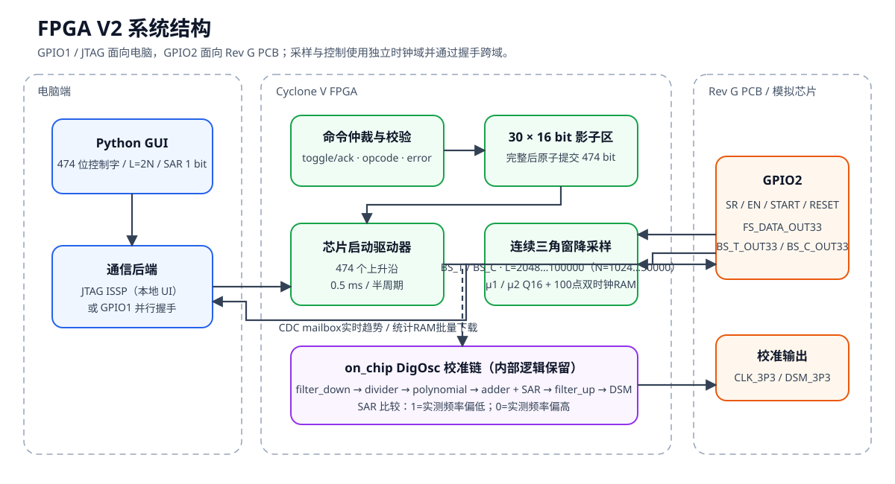

# FPGA V2：晶振芯片控制、连续采样、分批统计与 SAR 校准

`FPGA_V2` 是当前独立可综合工程。它保留 V1 已验证的 474-bit 芯片驱动、
连续三角窗降采样和 On-Chip DigOsc 行为，并新增：

- 四标签中文 GUI；
- V2 协议版本识别；
- μ1/μ2 最近 2000 点趋势图；
- FPGA 端固定 100 组双时钟统计缓存；
- 按用户“数据量”重复采集、下载并原子拼接 CSV；
- 可替换的专业频率测试仪器 Python 接口。

V1 目录保持不变。V2 不部署 SignalTap，也尚未绑定具体频率仪型号。



## 1. 新电脑部署

复制完整的 `FPGA_V2` 文件夹，不要只复制 `host` 或 `quartus`。工程不依赖
当前电脑的用户名、盘符、OneDrive 路径或固定工具安装目录。

需要安装：

1. Windows 10/11 和 PowerShell；
2. Python 3.10 或更高版本，并安装 Tcl/Tk 组件；GUI 只使用标准库；
3. Quartus Prime Lite 25.1std、Cyclone V 支持和 USB-Blaster 驱动；
4. 仅运行 RTL 仿真时需要 Questa FPGA Starter Edition。

工具可以放入 `PATH`，或通过 `QUARTUS_ROOTDIR`、
`QUARTUS_ROOTDIR_OVERRIDE`、`QUESTA_FSE_ROOT`、`QUESTA_ROOT` 指定。

从 `FPGA_V2` 根目录运行：

```powershell
# Python测试
python -m unittest discover -s .\host -p "test_*.py" -v

# RTL仿真
powershell -ExecutionPolicy Bypass -File .\scripts\simulate.ps1

# Quartus全编译
powershell -ExecutionPolicy Bypass -File .\scripts\build.ps1

# 启动GUI
powershell -ExecutionPolicy Bypass -File .\scripts\run_gui.ps1
```

构建和仿真的中间数据库位于系统临时目录；正式 `.sof`、Fitter 和 TimeQuest
摘要回写 `quartus/output_files`。脚本不会访问用户专属 FPGA 工作目录。

## 2. GUI

### 2.1 检查 FPGA 连接

连接检查验证：

- DE-SoC USB-Blaster；
- Cyclone V TAP；
- `OSCV` 64-bit source/probe；
- 只读协议版本寄存器 `0x0002`。

V1 和 V2 都使用 64-bit ISSP，因此仅检查位宽不能区分镜像。若版本不是
`0x0002`，GUI 会要求加载 `quartus/output_files/fpga_v2.sof`。
加载 SOF 会启动 `CLK_3P3` 等真实输出，必须先确认 PCB 电气安全。

### 2.2 控制字输入

控制字按用户理解分成：

- 芯片开关；
- CS 与三个 TRIM；
- ALPHA、7 个 Batch 系数和 8 个 Polynomial 系数。
- 控制字驱动样点数 `N_DAQ`，默认1500，允许在GUI中按次设置。

ALPHA 位于算法系数区，不与 CS/TRIM 混排。多 bit 字段直接输入定长二进制：

| 字段 | 位宽 |
|---|---:|
| CS | 2 |
| TRIM_C_COARSE | 3 |
| TRIM_C_FINE | 3 |
| TRIM_R_XO | 4 |
| ALPHA | 18 |
| 每个 Batch / Polynomial | 29 |

输入只允许 `0/1`；signed Q16 负数使用 29-bit 二进制补码位型。GUI 和批量
程序共用 `control_word.py` 与 `jtag_transport.py`。保存、载入 JSON 不会改变
474-bit 逻辑位序。

`N_DAQ` 只控制474-bit驱动事务的0.5 ms样点总数，不参与474-bit控制字打包，
也不等同于Filter的 `N_FILTER`。保持原有移位、使能、保护间隔和Reset时序
不变时，`N_DAQ` 最小为968；默认1500。`START_DLL` 和 `START_ANA` 在
本轮 `N_DAQ` 最末尾10个0.5 ms样点拉高，并在事务结束后继续保持为高，直到
下一轮控制字驱动开始或FPGA复位。

### 2.3 连续采样

FPGA 在 `FS_DATA_OUT33` 上升沿采样：

```text
μ1 ← BS_T_OUT33
μ2 ← BS_C_OUT33
```

三角窗总长为：

```text
L_FILTER = 2 × N_FILTER
weight = 0,1,…,N-1,N,N-1,…,1
sum(weight) = N_FILTER²
```

μ1、μ2 为 18-bit unsigned Q16，并限幅到 `0～1`。GUI 输入和显示总长
`L_FILTER=2048…100000`；协议传输半长 `N_FILTER=1024…50000`。新长度仅在窗口
边界生效。

时钟职责按参考 `filter_down_two_channel.v` 明确分开：

- `FS_DATA_OUT33` 是 `clk_SAMPLE`，只驱动两路 BS 采样和三角窗累加；
- FPGA 由 `CLOCK_50` 产生的 `CLK_3P3=2 MHz` 是 `clk_DATA`，驱动 SAR、
  Divider、Polynomial、Adder、Filter-up、Digital DSM 和统计捕获；
- 完整窗口结果通过“稳定数据 + 完成翻转位”从 FS 域送入 2 MHz 域；
- JTAG/GPIO、协议和 474-bit 驱动继续使用 `CLOCK_50`。

FS 停止时只会暂停新 μ 和统计样本；SAR 与电脑交互不会停止。完整的修改前/
修改后逐模块矩阵见
[docs/clock-reference-matrix.md](docs/clock-reference-matrix.md)。

趋势图纵轴固定 `0～1`，保留最近 2000 个主机读到或统计下载的点。实时 JTAG
趋势用于观察变化，可能跳过 FPGA 中间窗口；严格统计使用专用缓存。

### 2.4 分批统计与 CSV

“数据量”默认 100，必须是正数且为 100 的整数倍。每批流程：

1. FPGA 等待并丢弃点击前已开始的三角窗；
2. 连续捕获之后的 100 次 `mu_valid`；
3. 将 `{μ2[17:0], μ1[17:0]}` 保存在 128×36 bit 双时钟 RAM；
4. 主机用一次 JTAG 会话读取 300 个 16-bit 字；
5. 将该批追加到临时 CSV 和最近 2000 点趋势；
6. 若尚未达到数据量，再启动下一批。

每批 100 点内部严格连续。下载期间 FPGA 不启动下一批，因此允许批次之间存在
采样空档。整个统计任务期间禁止修改 Filter 长度。

CSV 文件名为：

```text
文件名_YYYYMMDD_HHMMSS.csv
```

默认目录为 `FPGA_V2/data/statistics`，GUI 可选择其他目录。CSV 列为：

```text
batch,mu1,mu2
```

`batch` 从 1 开始，每批恰好 100 行；μ1、μ2 的行数分别严格等于数据量。
不写 FPGA 样本序号。各批先写临时文件，全部完成后原子发布；失败不会留下
部分 CSV。

在本机 USB-Blaster 上，300 条只读命令约 1.35 秒。若
`L_FILTER=2048`、`FS_DATA_OUT33=500 kHz`，每批采集约 0.410 秒；
加上启动和状态查询后，典型每批约 2～3 秒。真实时间由实际 FS 和 JTAG
环境决定。

实时趋势读取采用 `OP_LATCH_LIVE_SAMPLE` 先在 FPGA 内部锁存 μ 快照，再读
该快照的分片寄存器。若 FPGA 在两次 GUI 轮询之间产生多个 μ，允许只显示最新
锁存的一点；但每个显示点内部的 μ1、μ2、样本序号和 Filter 长度必须来自同一
次锁存，不能混合新旧窗口。

### 2.5 遍历

“遍历”页用于直接驱动数字 DSM 输入。启用覆盖后，On-Chip 数字环路仍继续
计算 Divider、Polynomial、Adder 和 Filter-up 的原始结果，但 `digital_DSM`
实际输入由 GUI 写入的 29-bit signed Q16 值提供；点击“恢复环路”后重新连接
Filter-up 到 DSM 的原始路径。GUI 支持十进制 Q16 数值，也支持 `0x`、`0b`
或 29-bit 二进制原始二补码码字。

### 2.6 SAR 校准

SAR 页预留：

- 专业仪器实测频率只读显示，单位 MHz；
- “读取仪器”按钮；
- 目标频率输入；
- “实测低于目标 → 增大校准码”；
- “实测高于目标 → 减小校准码”。

仪器未配置时显示 `— MHz`，点击读取会给出后端未配置提示，仍可手动提交
语义判决。未来 VISA/SCPI、
厂商 SDK 或 LabVIEW IPC 只需实现 `FrequencyInstrumentBackend`，不能把
仪器型号耦合到 RTL。

当前 SAR 算法：

1. 启动产生 Q16 的 `0.5` 试探码；
2. 对 16 个小数位逐次二分；
3. `1` 表示实测偏低，保留当前位并增大下一试探码；
4. `0` 表示实测偏高，清除当前位并减小下一试探码；
5. 固定收到 16 次外部单 bit 判决后 `done=1`。

FPGA 不进行平均、多数投票、容差或提前结束。结果是 29-bit signed Q16、
范围 `0～1`，并注入：

```text
F     = A - B
E_cal = A - B + C_SAR
```

积分器再按 `polarity` 加/减 `E_cal` 并饱和。当前假设“校准码增大使输出频率
增大”；真实仪器若验证方向相反，只在 Python 后端反转判决。

SAR状态机运行在 FPGA 自身产生的 2 MHz 数据时钟域，不依赖
`FS_DATA_OUT33`。GUI发送启动命令后不会立即宣告成功，而是等待FPGA回读
`busy=1`、`step=0`、试探码=`0.5`；即使没有芯片或FS停止，该数字状态机
仍能启动。每次判决必须等待步数实际递增后才重新启用按钮。启动新一轮SAR
会先清除上一轮的粘滞协议错误。

状态轮询的“FPGA操作等待期限”和每次新建 `quartus_stp` 进程的“JTAG事务
期限”彼此独立。后者至少保留5秒，避免Quartus正常启动超过1秒时被主机误杀。
若仍出现JTAG会话超时，它属于电脑—USB-Blaster—FPGA链路，不代表外部芯片
或FS未连接。

## 3. V2 命令协议

| opcode | 功能 | index | data |
|---:|---|---|---|
| `0x1` | 写控制字块 | 0…29 | 16-bit块 |
| `0x2` | 原子提交并启动 | 0 | 芯片号/广播 |
| `0x3` | 设置 `N_FILTER` | 0 | 1024…50000 |
| `0x4` | 启动 SAR | 0 | bit0 enable |
| `0x5` | SAR 判决 | 0 | bit0 |
| `0x6` | 清错误 | 0 | 0 |
| `0x7` | 启动100点统计 | 0 | 0 |
| `0x8` | 读寄存器 | 0…26 | 0 |
| `0x9` | 读统计缓存 | 0…2 | 样本地址0…99 |
| `0xA` | 设置 `N_DAQ` | 0 | 968…65535 |
| `0xB` | 设置 DSM 输入覆盖 | 0/1/2 | 低16位/高13位/bit0 enable |
| `0xC` | 锁存实时 μ 快照 | 0 | 0 |

统计缓存把一个 36-bit 样本拆成：

```text
index 0 → packed[15:0]
index 1 → packed[31:16]
index 2 → {12'b0, packed[35:32]}
packed  = {μ2[17:0], μ1[17:0]}
```

新增读寄存器：

| index | 内容 |
|---:|---|
| 12 | bit3 request_active、bit2 busy、bit1 done、bit0 completion_toggle |
| 13 | 当前批捕获数量 |
| 14 | 协议版本 `0x0002` |
| 15 | 实际生效的 `N_FILTER` |
| 16 | 实现修订 `0x0004`；标识可配置 `N_DAQ`、START保持、DSM输入覆盖和实时μ快照 |
| 17 | 当前 `N_DAQ` |
| 18 | DSM输入覆盖 enable |
| 19 | DSM输入覆盖值低16位 |
| 20 | `{3'b0, DSM输入覆盖值[28:16]}` |
| 21 | 实时快照 μ1 低16位 |
| 22 | `{14'b0, 实时快照 μ1[17:16]}` |
| 23 | 实时快照 μ2 低16位 |
| 24 | `{14'b0, 实时快照 μ2[17:16]}` |
| 25 | 实时快照样本序号 |
| 26 | 实时快照 `N_FILTER` |

新增错误：

| 错误码 | 含义 |
|---:|---|
| `0x07` | 统计采集正忙 |
| `0x08` | 统计数据尚未准备完成 |
| `0x09` | 统计地址或分片无效 |
| `0x0A` | `N_DAQ` 超出968…65535 |
| `0x0B` | DSM输入覆盖值或命令索引无效 |

JTAG/GPIO1 继续使用 toggle/ack。64-bit Tcl 必须使用 `%llx/%llX`，并在
会话结束时把 request/ack 归零。

## 4. FPGA 驱动不变量

- 控制字与 `Matlab_Scripts/drive.m` 一致并整体反转一次；
- 严格产生 474 个 `SR_CLK` 上升沿；
- 第 474 个上升沿锁存 `BYPASS`；
- 默认半周期 25,000 个 50 MHz 周期，即 0.5 ms；
- `N_DAQ` 默认1500，对应750 ms；GUI/主机可按次设置；
- `START_DLL` 和 `START_ANA` 在 `N_DAQ` 最末尾10个样点拉高，事务结束后继续保持为高；
- 成功 COMMIT 后清空30块有效位图；
- 粘滞传输错误存在时禁止 COMMIT；
- `rtl/on_chip` 的符号、位宽与截断行为保持可复现。

## 5. 验证

Python：

```powershell
python -m unittest discover -s .\host -p "test_*.py" -v
python -m py_compile `
  .\host\control_word.py `
  .\host\jtag_transport.py `
  .\host\acquisition.py `
  .\host\instrument_backend.py `
  .\host\gui.py
```

Questa 回归包括：

- 474-bit 驱动时序；
- FS采样/2 MHz数据双时钟边界、连续三角窗及运行时长度切换；
- 100点窗口对齐、双时钟 RAM 与重新启动；
- V2 核心协议、统计读回、Filter 锁定、μ，以及FS停止时SAR仍运行；
- JTAG/GPIO 保持型请求只消费一次及异步邮箱压力测试。

Quartus 全编译必须达到：

- 0 error；
- 四个约束时钟 setup/hold TNS 均为 0；
- 统计缓存映射到片上 block memory；
- 产出 `quartus/output_files/fpga_v2.sof`。

2026-07-31 的本机“实时 μ 快照”修改后回归结果：

- Python 31 项测试全部通过；
- Questa `vlog -lint` 编译为 0 error / 0 warning；`vsim` 因
  `SALT_LICENSE_SERVER` 许可证 checkout 失败未完成运行；
- Quartus Prime 25.1std Full Compilation 为 0 error；
- 统计缓存推断为 128×36 bit 双时钟片上 RAM；工程共使用 4,659 bit、
  2 个 RAM block；
- 逻辑利用率 5,711 / 32,070 ALM（18%），15 个 DSP；
- 全部 PVT 角落、全部四个约束时钟的 setup/hold TNS 均为 0；
- 已生成 6,696,187 byte 的 `fpga_v2.sof`。

Quartus 仍报告与 V1 相同的板级约束提示，包括 `KEY[0]`、
`FS_DATA_OUT33` 使用非专用时钟布线，以及异步/外部接口并非全部参与同步
setup/hold 分析；这些提示未造成负 slack。统计 RAM 另有双时钟
read-during-write 未定义提示，但协议保证捕获写入期间禁止读取，读回只在
`done=1` 后开始。

## 6. 目录与边界

```text
FPGA_V2/
├─ rtl/                 V2 RTL 与 on_chip 兼容副本
├─ sim/                 自检 testbench
├─ quartus/             Rev G 约束与编程产物
├─ host/                控制字、JTAG、统计、仪器接口与GUI
├─ scripts/             工具发现、仿真、构建、GUI启动
├─ data/statistics/     GUI运行时默认CSV目录
└─ docs/images/         架构与验证图
```

当前边界：

- 未部署 SignalTap；
- 未完成真实 PCB 电气联调；
- `FS_DATA_OUT33` 暂按 500 kHz 约束；
- 未绑定专业频率仪型号；
- GUI 不会自动加载 SOF。
