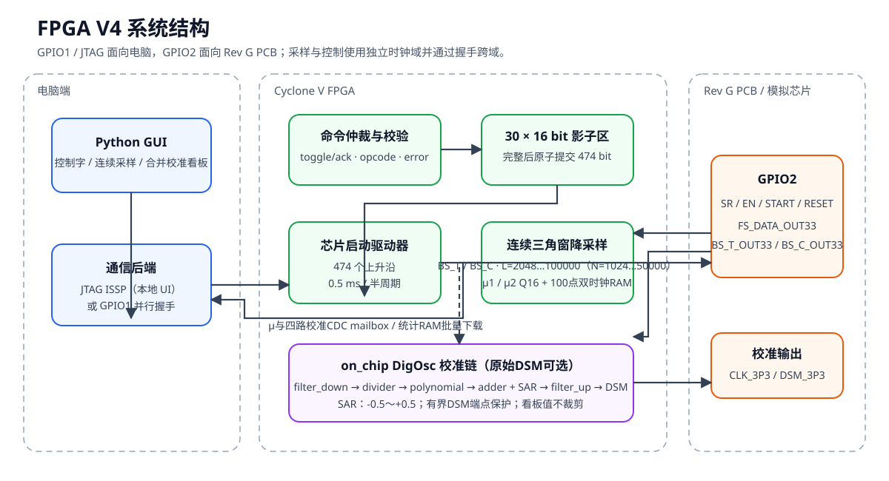

# FPGA V6：V4协议兼容的晶振控制、监控、校准与 DSM 扫描

`FPGA_V6` 是从 `FPGA_V5` 完整复制出的独立 host/UI 分支。它沿用 V4 已验证的
474-bit 芯片驱动、连续三角窗降采样、On-Chip DigOsc、SAR、JTAG opcode 和
`fpga_v4.sof`，本版本只重组 GUI 并新增数字 DSM 扫描：

- 五标签中文 GUI：`FPGA连接`、`芯片控制`、`监控`、`校准`、`多温度点校准`；
- V4 协议版本 `0x0004` 识别；
- 监控页显示仪器频率、μ1/μ2 与片内 μ1/μ2 最近 1000 点趋势图；
- FPGA 端固定 100 组双时钟统计缓存；
- 按用户“数据量”重复采集、下载并原子拼接 CSV；
- Keysight/Agilent 53220A PyVISA 频率仪后端（接口仍可替换，自动检索 `*IDN?`）。
- 可调 gate time 的频率测量；
- 数字 DSM 输入覆盖和数字 DSM 扫描长表 CSV；
- 多温度点、五芯片、三组 `TRIM_C_COARSE` 的批量校准流程；
- Keithley DMM7510 四线电阻温敏读数后端（接口位于host层，可替换）；
- 四路29-bit signed Q16校准链路实时看板与最近1000点趋势；
- 端点精确、内部状态有界的数字DSM默认实现。

V1/V2/V3/V4/V5 目录保持不变。V6 不部署 SignalTap；当前频率实测默认使用
Keysight/Agilent 53220A，仪器耦合只在 host 层，SAR/RTL 逻辑不随本次接入改变。



## 1. 新电脑部署

复制完整的 `FPGA_V6` 文件夹，不要只复制 `host` 或 `quartus`。工程不依赖
当前电脑的用户名、盘符、OneDrive 路径或固定工具安装目录。

需要安装：

1. Windows 10/11 和 PowerShell；
2. Python 3.10 或更高版本，并安装 Tcl/Tk 组件；GUI 基础功能只使用标准库；
3. 使用 53220A 实测频率时，安装 Keysight IO Libraries Suite，并运行
   `python -m pip install pyvisa`；
4. Quartus Prime Lite 25.1std、Cyclone V 支持和 USB-Blaster 驱动；
5. 仅运行 RTL 仿真时需要 Questa FPGA Starter Edition。

工具可以放入 `PATH`，或通过 `QUARTUS_ROOTDIR`、
`QUARTUS_ROOTDIR_OVERRIDE`、`QUESTA_FSE_ROOT`、`QUESTA_ROOT` 指定。

从 `FPGA_V6` 根目录运行：

```powershell
# Python测试
python -m unittest discover -s .\host -p "test_*.py" -v

# RTL仿真
powershell -ExecutionPolicy Bypass -File .\scripts\simulate.ps1

# Quartus全编译
powershell -ExecutionPolicy Bypass -File .\scripts\build.ps1

# 启动GUI
powershell -ExecutionPolicy Bypass -File .\scripts\run_gui.ps1

# 53220A频率仪链路检查；自动枚举VISA资源，不需要填写USB地址
python -m pip install pyvisa
pyvisa-info
python .\host\verify_keysight_53220a.py --list-only
python .\host\verify_keysight_53220a.py --samples 3

# DMM7510温敏电阻链路检查；自动枚举VISA资源，不需要填写USB地址
python .\host\verify_keithley_dmm7510.py --list-only
python .\host\verify_keithley_dmm7510.py --samples 3
```

构建和仿真的中间数据库位于系统临时目录；正式 `.sof`、Fitter 和 TimeQuest
摘要回写 `quartus/output_files`。脚本不会访问用户专属 FPGA 工作目录。

## 2. GUI

### 2.1 FPGA连接

连接检查验证：

- DE-SoC USB-Blaster；
- Cyclone V TAP；
- `OSCV` 64-bit source/probe；
- 只读协议版本寄存器 `0x0004`。

V1、V2、V3 和 V4 都使用 64-bit ISSP，因此仅检查位宽不能区分镜像。若版本不是
`0x0004`，GUI 会要求加载 `quartus/output_files/fpga_v4.sof`。
加载 SOF 会启动 `CLK_3P3` 等真实输出，必须先确认 PCB 电气安全。

### 2.2 芯片控制

控制字按用户理解分成：

- 芯片开关；
- CS 与三个 TRIM；
- ALPHA、7 个 Batch 系数和 8 个 Polynomial 系数。
- 控制字驱动样点数 `N_DAQ`，默认1500，允许在GUI中按次设置。

ALPHA 位于算法系数区，不与 CS/TRIM 混排。多 bit 字段直接输入定长二进制：

| 字段 | 位宽 |
|---|---:|
| CS | 2 |
| TRIM_C_COARSE | 3 |
| TRIM_C_FINE | 3 |
| TRIM_R_XO | 4 |
| ALPHA | 18 |
| 每个 Batch / Polynomial | 29 |

CS 和三个 TRIM 仍直接输入定长二进制码字。ALPHA 在 GUI 中输入十进制
unsigned Q2.16 数值，Batch/Polynomial 在 GUI 中输入十进制 signed Q12.16
数值，Python 会统一换算为既有 18-bit/29-bit 二进制码字；signed Q16 负数
最终使用 29-bit 二进制补码位型。GUI 和批量程序共用 `control_word.py` 与
`jtag_transport.py`。保存、载入 JSON 不会改变474-bit 逻辑位序。

`N_DAQ` 只控制474-bit驱动事务的0.5 ms样点总数，不参与474-bit控制字打包，
也不等同于Filter的 `N_FILTER`。保持原有移位、使能、保护间隔和Reset时序
不变时，`N_DAQ` 最小为968；默认1500。`START_DLL` 和 `START_ANA` 在
本轮 `N_DAQ` 最末尾10个0.5 ms样点拉高，并在事务结束后继续保持为高，直到
下一轮控制字驱动开始或FPGA复位。`RESET` 为一拍脉冲，发生在 START 已经拉高
之后的倒数第五个0.5 ms样点。该 `RESET` 脉冲同时作为片内数字算法域的运行
复位；主机/JTAG命令通路和已经同步的474-bit控制字配置不被该脉冲清空。

### 2.3 监控

FPGA 在 `FS_DATA_OUT33` 上升沿采样：

```text
μ1 ← BS_T_OUT33
μ2 ← BS_C_OUT33
```

三角窗总长为：

```text
L_FILTER = 2 × N_FILTER
weight = 0,1,…,N-1,N,N-1,…,1
sum(weight) = N_FILTER²
```

μ1、μ2 为 18-bit unsigned Q16，并限幅到 `0～1`。GUI 输入和显示总长
`L_FILTER=2048…100000`；协议传输半长 `N_FILTER=1024…50000`。新长度仅在窗口
边界生效。

时钟职责按参考 `filter_down_two_channel.v` 明确分开：

- `FS_DATA_OUT33` 是 `clk_SAMPLE`，只驱动两路 BS 采样和三角窗累加；
- FPGA 由 `CLOCK_50` 产生的 `CLK_3P3=2 MHz` 是 `clk_DATA`，驱动 SAR、
  Divider、Polynomial、Adder、Filter-up、Digital DSM 和统计捕获；
- 完整窗口结果通过“稳定数据 + 完成翻转位”从 FS 域送入 2 MHz 域；
- JTAG/GPIO、协议和 474-bit 驱动继续使用 `CLOCK_50`。

FS 停止时只会暂停新 μ 和统计样本；SAR 与电脑交互不会停止。完整的修改前/
修改后逐模块矩阵见
[docs/clock-reference-matrix.md](docs/clock-reference-matrix.md)。

趋势图纵轴固定 `0～1`，保留最近 1000 个主机读到或统计下载的点。实时 JTAG
趋势用于观察变化，可能跳过 FPGA 中间窗口；严格统计使用专用缓存。
V4 看板同时显示可调三角窗的 μ1/μ2，以及 On-Chip 兼容路径中
`filter_down_two_clock` 在 valid 后输出的片内 μ1/片内 μ2。

### 2.4 分批统计与 CSV

“数据量”默认 100，必须是正数且为 100 的整数倍。每批流程：

1. FPGA 等待并丢弃点击前已开始的三角窗；
2. 连续捕获之后的 100 次 `mu_valid`；
3. 将 `{μ2[17:0], μ1[17:0]}` 保存在 128×36 bit 双时钟 RAM；
4. 主机用一次 JTAG 会话读取 300 个 16-bit 字；
5. 将该批追加到临时 CSV 和最近 1000 点趋势；
6. 若尚未达到数据量，再启动下一批。

每批 100 点内部严格连续。下载期间 FPGA 不启动下一批，因此允许批次之间存在
采样空档。整个统计任务期间禁止修改 Filter 长度。

CSV 文件名为：

```text
文件名_YYYYMMDD_HHMMSS.csv
```

默认目录为 `FPGA_V6/data/statistics`，GUI 可选择其他目录。CSV 列为：

```text
batch,mu1_1,...,mu1_100,mu2_1,...,mu2_100
```

`batch` 从 1 开始，每批恰好写成 1 行，行内包含100个 μ1 和100个 μ2。
不写 FPGA 样本序号。各批先写临时文件，全部完成后原子发布；失败不会留下
部分 CSV。

在本机 USB-Blaster 上，300 条只读命令约 1.35 秒。若
`L_FILTER=2048`、`FS_DATA_OUT33=500 kHz`，每批采集约 0.410 秒；
加上启动和状态查询后，典型每批约 2～3 秒。真实时间由实际 FS 和 JTAG
环境决定。

实时趋势读取采用 `OP_LATCH_LIVE_SAMPLE` 先在 FPGA 内部锁存一个四路 μ
批次，再读该批次的分片寄存器。若 FPGA 在两次 GUI 轮询之间产生多个 μ，
允许只显示最新锁存的一点；但每个显示点内部的 μ1、μ2、片内 μ1、片内 μ2、
样本序号和 Filter 长度必须来自同一次锁存，不能混合新旧窗口。

### 2.5 校准界面

校准页按顺序提供：

- 数字DSM输入覆盖、恢复环路和覆盖状态读取；
- 数字DSM扫描：输入“扫描总数”和“文件名”，点击“开始扫描”后从 -0.5 到
  +0.5 等间距扫描，每点稳定5 s，读取一次当前 gate time 的频率和100个μ样本。
  CSV每个DSM点写1行，列为
  `scan_index,dsm_q16,frequency_mhz,mu1_1,...,mu1_100,mu2_1,...,mu2_100`；
- 统计μ值；
- SAR校准及目标频率输入；
- “实测低于目标 → 增大校准码”；
- “实测高于目标 → 减小校准码”。

监控页显示专业仪器实测频率、μ看板和校准链路看板。校准链路看板包含
`poly_engine_freq`、`poly_engine_system`、实际注入adder的SAR值和DSM实际
输入四路最新值及最近1000点趋势。看板只显示Q16工程值，不显示raw码字、有效位
或采样序号等底层传输信息。

启用覆盖后，On-Chip环路仍继续计算Divider、Polynomial、Adder和Filter-up，
但DSM实际输入改为GUI写入的29-bit signed Q16值。GUI支持十进制Q16，也支持
`0x`、`0b`或29-bit二补码原始码字，并允许输入±0.5以外的完整29-bit值。

DSM有效映射为：

```text
输入 <= -0.5  → 输出全0
-0.5 < 输入 < 0.5 → density = 输入 + 0.5，16-bit模累加进位作为输出
输入 >= +0.5  → 输出全1
```

端点保护只影响DSM输出，不改写读回值。看板继续显示小于-0.5或大于+0.5的
真实Q16值，自动扩展纵轴，并明确标记下溢/上溢。强制端点时清空相位状态，
因此不会受此前调制残量影响。V3原始DSM完整保留为可选reference path。

当前默认仪器后端为 `Keysight53220ABackend`。GUI 进入“监控”页且持续读取
开启时，会用当前 gate time 配置 53220A 并持续读取 `READ?` 返回值，按 MHz
显示在“专业仪器实测频率”栏；gate time默认5 s，可在监控页对话框中修改，并
对手动读数、持续读数、SAR相关显示和DSM扫描读数全局生效。首次读取通过 PyVISA
枚举 VISA resources，并对
每个候选资源查询 `*IDN?`；第一个返回内容包含 `53220A` 的仪器会被自动选中，
因此不同电脑上 USB 端口、USB instance 或 Connection Expert 别名变化时不需要
修改源码。若实验室确实需要指定设备，可用环境变量 `KEYSIGHT_53220A_RESOURCE`
或验证脚本的 `--resource` 参数覆盖；`KEYSIGHT_VISA_LIBRARY` 可用于指定 VISA
DLL。仪器未安装、未连接或未被 VISA 发现时，GUI 显示读取失败提示，仍可手动提交
语义判决。

该接入只改变主机端频率读数来源，暂不修改 FPGA SAR 逻辑。未来其他 VISA/SCPI、
厂商 SDK 或 LabVIEW IPC 只需实现 `FrequencyInstrumentBackend`，不能把仪器型号
耦合到 RTL。

### 2.6 多温度点校准

“多温度点校准”页自动执行：

```text
温度点 → chip编号升序 → TRIM_C_COARSE_1/2/3 → 16步校准
```

每个温度点先按“等待时间”倒计时，再进入“测试时间”窗口。所有选中chip和三组
`TRIM_C_COARSE` 完成得比测试时间早时，GUI会补足剩余时间；若实际运行超过测试时间，
不截断当前温度点流程，而是记录状态后立即进入下一温度点。

每个chip的每个 `TRIM_C_COARSE` 都先通过既有 `configure_and_start()` 写入474位
控制字并启动。该chip完成三组COARSE后，GUI会把 `EN_XO=0` 写回一次以关闭该chip
晶振。常规SAR模式复用FPGA 16步SAR；DSM覆盖SAR模式不启动FPGA SAR，而是在host侧
对 `-0.5～+0.5` 的DSM覆盖输入做16步二分。已知DSM输入越大输出频率越低，因此实测
低于目标时降低DSM上界，实测高于目标时提高DSM下界。

FPGA_V6 在每个 chip/TRIM 写入控制字后，会先用 53220A 的 `1 s` gate time 做启动
诊断，并自动恢复原 gate time。默认只有诊断频率位于 `1.9～2.1 MHz` 才继续进入
校准；上下限可在多温度页修改。连续5次启动诊断失败会写入 `record_status=ERROR`
的 `sar_step=0` 失败行，并跳过当前TRIM。

多温度流程运行期间会阻止Windows系统睡眠但允许息屏，并禁止关闭GUI窗口。仪器读数、
JTAG统计采集、校准快照等突发错误会写入日志和失败CSV行，然后结束当前TRIM并继续
后续流程，不再用弹窗中断长时间测试。

温敏信息来自 Keithley DMM7510 四线电阻读数。首次读取时通过 PyVISA 枚举资源并用
`*IDN?` 匹配 `DMM7510`；可用 `KEITHLEY_DMM7510_RESOURCE` 或 `KEITHLEY_VISA_LIBRARY`
临时指定资源或VISA库。若DMM7510或驱动暂不可用，多温度流程会把
`thermistor_ohm` 写为空，并继续校准。

输出目录为：

```text
保存目录/文件名_YYYYMMDD_HHMMSS/
  multi_temperature.log
  temp_001/
    chip0_trim1_000.csv
    ...
  temp_002/
    ...
  chip0_summary.csv
  chip1_summary.csv
```

明细和汇总CSV列包含：

```text
temp_index,chip,target_frequency_mhz,trim_c_coarse,sar_step,record_status,
thermistor_ohm,frequency_mhz,sar_q16,dsm_q16,
poly_engine_freq,poly_engine_system,mu1_1...mu1_100,mu2_1...mu2_100
```

成功行为 `record_status=OK`；启动失败或关键读取失败行为 `record_status=ERROR`。
失败行会保留已读到的字段，失败阶段之后未取得的数值和μ列留空。详细错误原因写入
运行目录根部的 `multi_temperature.log`，日志格式为
`YYYY-MM-DD HH:MM:SS.mmm [LEVEL] [CATEGORY] message`。

流程失败或用户点击“停止”时，已经发布的chip/TRIM明细CSV会保留，并在运行目录根部
生成已完成部分的每chip汇总CSV；正在写入但未发布的明细临时文件会清理。

当前 SAR 算法：

1. 搜索区间固定为 `-0.5～+0.5`，启动时首个试探码为区间中点 `0`；
2. 之后按 `±0.25`、`±0.125` 直到1 LSB逐次二分；
3. `1` 表示实测偏低，保留当前位并增大下一试探码；
4. `0` 表示实测偏高，清除当前位并减小下一试探码；
5. 固定收到 16 次外部单 bit 判决后 `done=1`。

FPGA 不进行平均、多数投票、容差或提前结束。结果是 29-bit signed Q16、
范围 `-0.5～+0.5`，并注入：

```text
F     = A - B
E_cal = A - B + C_SAR
```

`adder`是按有效样本更新的离散积分器：`polar=0`时
`D_next=sat29(D_previous+E_cal_ext)`，`polar=1`时执行减法。A/B/SAR/polar
先锁存，下一拍计算差值、校准误差和积分寄存器，再下一拍发布D/F/E_cal与
`valid_out`。积分使用未截断扩展位宽的`A-B+calibration`，只在最终D处饱和到
29-bit signed范围，不发生29-bit回绕。当前假设“校准码增大使输出频率增大”；
真实仪器若验证方向相反，只在Python后端反转判决。

SAR状态机运行在 FPGA 自身产生的 2 MHz 数据时钟域，不依赖
`FS_DATA_OUT33`。GUI发送启动命令后不会立即宣告成功，而是等待FPGA回读
`busy=1`、`step=0`、试探码=`0`；即使没有芯片或FS停止，该数字状态机
仍能启动。每次判决必须等待步数实际递增后才重新启用按钮。启动新一轮SAR
会先清除上一轮的粘滞协议错误。

状态轮询的“FPGA操作等待期限”和每次新建 `quartus_stp` 进程的“JTAG事务
期限”彼此独立。后者至少保留5秒，避免Quartus正常启动超过1秒时被主机误杀。
若仍出现JTAG会话超时，它属于电脑—USB-Blaster—FPGA链路，不代表外部芯片
或FS未连接。

## 3. V4 命令协议

| opcode | 功能 | index | data |
|---:|---|---|---|
| `0x1` | 写控制字块 | 0…29 | 16-bit块 |
| `0x2` | 原子提交并启动 | 0 | 芯片号/广播 |
| `0x3` | 设置 `N_FILTER` | 0 | 1024…50000 |
| `0x4` | 启动 SAR | 0 | bit0 enable |
| `0x5` | SAR 判决 | 0 | bit0 |
| `0x6` | 清错误 | 0 | 0 |
| `0x7` | 启动100点统计 | 0 | 0 |
| `0x8` | 读寄存器 | 0…41 | 0 |
| `0x9` | 读统计缓存 | 0…2 | 样本地址0…99 |
| `0xA` | 设置 `N_DAQ` | 0 | 968…65535 |
| `0xB` | 设置 DSM 输入覆盖 | 0/1/2 | 低16位/高13位/bit0 enable |
| `0xC` | 锁存实时 μ 快照 | 0 | 0 |
| `0xD` | 锁存校准链路快照 | 0 | 0 |

统计缓存把一个 36-bit 样本拆成：

```text
index 0 → packed[15:0]
index 1 → packed[31:16]
index 2 → {12'b0, packed[35:32]}
packed  = {μ2[17:0], μ1[17:0]}
```

新增读寄存器：

| index | 内容 |
|---:|---|
| 6 | SAR校准码低16位 |
| 7 | `{3'b0, SAR校准码[28:16]}`，支持负signed Q16码 |
| 12 | bit3 request_active、bit2 busy、bit1 done、bit0 completion_toggle |
| 13 | 当前批捕获数量 |
| 14 | 协议版本 `0x0004` |
| 15 | 实际生效的 `N_FILTER` |
| 16 | V4 实现修订 `0x0003`；标识有界DSM、`±0.5` SAR和控制字RESET数字复位 |
| 17 | 当前 `N_DAQ` |
| 18 | DSM输入覆盖 enable |
| 19 | DSM输入覆盖值低16位 |
| 20 | `{3'b0, DSM输入覆盖值[28:16]}` |
| 21 | 实时快照 μ1 低16位 |
| 22 | `{14'b0, 实时快照 μ1[17:16]}` |
| 23 | 实时快照 μ2 低16位 |
| 24 | `{14'b0, 实时快照 μ2[17:16]}` |
| 25 | 实时快照片内 μ1 低16位 |
| 26 | `{14'b0, 实时快照片内 μ1[17:16]}` |
| 27 | 实时快照片内 μ2 低16位 |
| 28 | `{14'b0, 实时快照片内 μ2[17:16]}` |
| 29 | 实时快照样本序号 |
| 30 | 实时快照 `N_FILTER` |
| 31 | 实时快照片内样本序号 |
| 32/33 | 校准快照 `poly_engine_freq` 低16位/高13位 |
| 34/35 | 校准快照 `poly_engine_system` 低16位/高13位 |
| 36/37 | 校准快照实际SAR校准输入低16位/高13位 |
| 38/39 | 校准快照DSM实际输入低16位/高13位 |
| 40 | 校准快照序号 |
| 41 | bit1快照有效、bit0 DSM覆盖已启用 |

新增错误：

| 错误码 | 含义 |
|---:|---|
| `0x07` | 统计采集正忙 |
| `0x08` | 统计数据尚未准备完成 |
| `0x09` | 统计地址或分片无效 |
| `0x0A` | `N_DAQ` 超出968…65535 |
| `0x0B` | DSM输入覆盖值或命令索引无效 |

JTAG/GPIO1 继续使用 toggle/ack。64-bit Tcl 必须使用 `%llx/%llX`，并在
会话结束时把 request/ack 归零。

## 4. FPGA 驱动不变量

- 控制字与 `Matlab_Scripts/drive.m` 一致并整体反转一次；
- 严格产生 474 个 `SR_CLK` 上升沿；
- 第 474 个上升沿锁存 `BYPASS`；
- 默认半周期 25,000 个 50 MHz 周期，即 0.5 ms；
- `N_DAQ` 默认1500，对应750 ms；GUI/主机可按次设置；
- `START_DLL` 和 `START_ANA` 在 `N_DAQ` 最末尾10个样点拉高，事务结束后继续保持为高；
- `RESET` 在 `START_DLL`/`START_ANA` 拉高后的倒数第五个样点拉高一拍；
- 成功 COMMIT 后清空30块有效位图；
- 粘滞传输错误存在时禁止 COMMIT；
- `rtl/on_chip` 的符号、位宽与截断行为保持可复现。
- 修正版DSM为默认路径，原始DSM由`USE_REFERENCE_DSM`选择用于复现。

## 5. 验证

Python：

```powershell
python -m unittest discover -s .\host -p "test_*.py" -v
python -m py_compile `
  .\host\control_word.py `
  .\host\jtag_transport.py `
  .\host\acquisition.py `
  .\host\instrument_backend.py `
  .\host\gui.py
```

Questa 回归包括：

- 474-bit 驱动时序；
- FS采样/2 MHz数据双时钟边界、连续三角窗及运行时长度切换；
- 100点窗口对齐、双时钟 RAM 与重新启动；
- V4 核心协议、统计读回、Filter 锁定、μ，以及FS停止时SAR仍运行；
- JTAG/GPIO 保持型请求只消费一次及异步邮箱压力测试。

Quartus 全编译必须达到：

- 0 error；
- 用户设计时钟 `CLOCK_50`、`CORE_CLK_2MHZ`、`FS_SAMPLE_CLK` 的 setup/hold
  TNS 均为 0；
- 统计缓存映射到片上 block memory；
- 产出 `quartus/output_files/fpga_v4.sof`。

2026-08-01 的本机完整 V4 回归结果：

- Python 35 项测试全部通过，全部主机模块通过 `py_compile`；
- Questa `vlog -lint` 为 0 error / 0 warning，9 个自检 testbench 全部 PASS，
  包含数字DSM端点、占空比、长时间运行、饱和切换，以及adder极性、积分、
  流水线、保持和饱和测试，并验证SAR的`-0.5/0/+0.5`和负数寄存器读回；
- Quartus Prime 25.1std Full Compilation 成功；
- 统计缓存推断为片上 RAM；工程共使用 4,659 bit、2 个 RAM block；
- 逻辑利用率 5,957 / 32,070 ALM（19%），6,645 个寄存器、16 个 DSP；
- 全部列出的 PVT 角落中，三个用户设计时钟的 setup/hold TNS 均为 0；
- Quartus 生成的 SLD/JTAG 保留时钟 `altera_reserved_tck` 的 setup/hold
  TNS 也均为 0；
- 已产出 6,696,188 字节的 `quartus/output_files/fpga_v4.sof`，SHA-256 为
  `1994F80F65A29C88153042510E4A3CEB076B7919CD088BF3C3DB18B004533EAF`。

Quartus 仍报告与 V1 相同的板级约束提示，包括 `KEY[0]`、
`FS_DATA_OUT33` 使用非专用时钟布线，以及异步/外部接口并非全部参与同步
setup/hold 分析；这些提示未造成负 slack。统计 RAM 另有双时钟
read-during-write 未定义提示，但协议保证捕获写入期间禁止读取，读回只在
`done=1` 后开始。

## 6. 目录与边界

```text
FPGA_V6/
├─ rtl/                 V4 RTL 与 on_chip 兼容副本
├─ sim/                 自检 testbench
├─ quartus/             Rev G 约束与编程产物
├─ host/                控制字、JTAG、统计、仪器接口与GUI
├─ scripts/             工具发现、仿真、构建、GUI启动
├─ data/statistics/     GUI运行时默认CSV目录
└─ docs/images/         架构与验证图
```

当前边界：

- 未部署 SignalTap；
- 未完成真实 PCB 电气联调；
- `FS_DATA_OUT33` 暂按 500 kHz 约束；
- 频率实测当前绑定到 host 层 Keysight/Agilent 53220A PyVISA 后端，不改变 RTL/SAR；
- GUI 不会自动加载 SOF。
