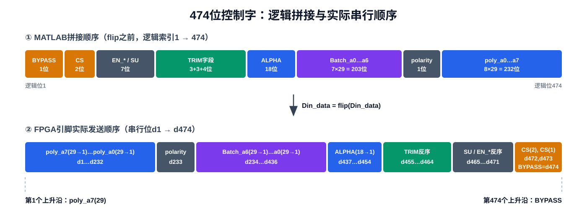
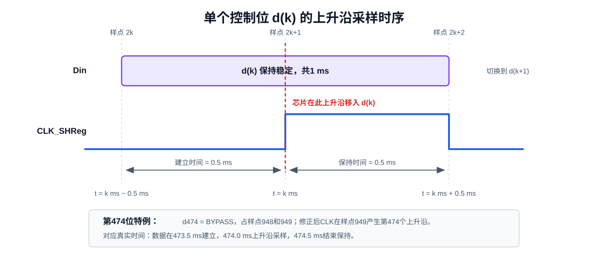
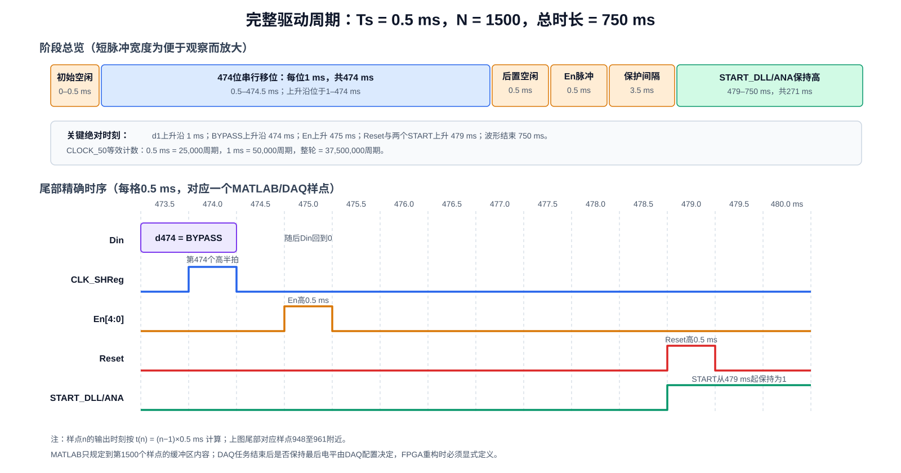

# MATLAB `drive.m` 芯片驱动逻辑与 FPGA/Python 重构基准

## 1. 文档目的

本文详细记录现有 [`Matlab_Scripts/drive.m`](Matlab_Scripts/drive.m) 的控制字组成、位序、地址与使能选择、DAQ样点波形及芯片启动流程，并把已确认的样点参数换算成真实时间。

本文将作为后续两部分工作的行为基准：

1. 在 FPGA 中重现原 MATLAB/DAQ 产生的严格 GPIO 时序；
2. 在 Python 中实现可由 GUI 和批量测试程序共同调用的控制字打包与驱动接口。

本文只描述当前已经确认的数字控制逻辑，不包含：

- 专业频率测试仪器的数据读取；
- SignalTap部署；
- FPGA与模拟芯片的实际PCB管脚约束；
- FPGA GPIO与芯片I/O的电压兼容性。

后两项在连接真实芯片前仍需单独确认，但不影响本文对数字协议和相对时序的定义。

## 2. 已确认的基准参数

| 参数 | 当前基准值 | 含义 |
|---|---:|---|
| 控制字长度 | 474 bit | 每次写入芯片移位寄存器的数据位数 |
| 芯片采样边沿 | `CLK_SHReg`上升沿 | 每个上升沿移入一位 |
| 单个DAQ样点周期 `Ts` | 0.5 ms | 每个MATLAB数组元素对应的输出保持时间 |
| 等效DAQ采样率 `fs` | 2 kS/s | `fs = 1/Ts` |
| 每位持续时间 | 1 ms | 每位占两个样点 |
| `CLK_SHReg`周期 | 1 ms | 一个低半拍加一个高半拍 |
| `CLK_SHReg`频率 | 1 kHz | `fCLK = fs/2` |
| 波形样点数 `N` | 1500 | 每个输出通道的数组长度 |
| 一轮波形总时长 | 750 ms | `N × Ts` |
| FPGA参考时钟 | 50 MHz | 来自DE1-SoC的`CLOCK_50` |
| 一个0.5 ms半拍 | 25,000个`CLOCK_50`周期 | FPGA重构计数基准 |
| 一个1 ms位周期 | 50,000个`CLOCK_50`周期 | FPGA重构计数基准 |
| 一轮750 ms周期 | 37,500,000个`CLOCK_50`周期 | FPGA重构计数基准 |

## 3. 现有脚本在系统中的角色

`drive.m`不是独立MATLAB函数。它没有函数签名、默认参数或显式返回值，而是依赖LabVIEW/MATLAB Script Node预先提供变量。

现有工作链路可概括为：

```text
LabVIEW前面板/测试程序
    ↓ 提供控制字段、chip_num、sel、N
MATLAB Script Node执行drive.m
    ↓ 生成多个长度为N的0/1数组
DAQ以固定采样率同步输出各数组
    ↓
PCB上的地址、Din、CLK、En、Reset、START引脚
    ↓
模拟芯片完成控制字移位、锁存和启动
```

MATLAB脚本只生成“第几个样点输出0或1”，真实时间由DAQ采样率决定。

本项目把样点周期固定为0.5 ms后，任意样点 `n` 对应的输出时刻定义为：

```text
t(n) = (n - 1) × 0.5 ms
```

例如：

```text
样点1   → 0 ms
样点2   → 0.5 ms
样点3   → 1.0 ms
样点949 → 474.0 ms
样点951 → 475.0 ms
样点959 → 479.0 ms
```

## 4. 脚本输入与输出

### 4.1 流程和目标选择输入

| 输入 | 作用 |
|---|---|
| `N` | 所有DAQ输出数组的目标样点数，当前取1500 |
| `chip_num` | 目标芯片/地址编号 |
| `sel` | 决定单目标使能还是广播使能 |

### 4.2 控制字字段输入

标量数值字段：

```text
BYPASS
EN_BIAS
EN_DLLBUF
EN_INTBUF
EN_SENSOR
EN_XO
EN_XOBUFA
SU
polarity
```

当前脚本期望为字符形式的二进制字段：

```text
CS                 2位
TRIM_C_COARSE      3位
TRIM_C_FINE        3位
TRIM_R_XO          4位
ALPHA             18位
Batch_a0…Batch_a6  每个29位
poly_a0…poly_a7    每个29位
```

例如：

```matlab
(CS(1)-'0')
```

将字符 `'0'` 或 `'1'` 转为数值0或1。

原脚本没有进行类型、长度和取值检查。Python重构必须在访问硬件前确保：

- 标量只能为0或1；
- 每个字段长度与定义一致；
- 字符串只能包含`0`和`1`；
- 最终逻辑控制字长度严格等于474；
- 最终串行数组中的每个元素只能为整数0或1。

### 4.3 输出

地址标量：

```text
Address1
Address2
Address3
```

长度为 `N=1500` 的同步波形：

```text
Din
CLK_SHReg
En0
En1
En2
En3
En4
Reset
START_DLL
START_ANA
```

## 5. 474位控制字

### 5.1 MATLAB逻辑拼接顺序

`drive.m`首先按以下顺序构造 `Din_data`：

| 逻辑索引 | 字段 | 位数 |
|---:|---|---:|
| 1 | `BYPASS` | 1 |
| 2–3 | `CS(1:2)` | 2 |
| 4 | `EN_BIAS` | 1 |
| 5 | `EN_DLLBUF` | 1 |
| 6 | `EN_INTBUF` | 1 |
| 7 | `EN_SENSOR` | 1 |
| 8 | `EN_XO` | 1 |
| 9 | `EN_XOBUFA` | 1 |
| 10 | `SU` | 1 |
| 11–13 | `TRIM_C_COARSE(1:3)` | 3 |
| 14–16 | `TRIM_C_FINE(1:3)` | 3 |
| 17–20 | `TRIM_R_XO(1:4)` | 4 |
| 21–38 | `ALPHA(1:18)` | 18 |
| 39–67 | `Batch_a0(1:29)` | 29 |
| 68–96 | `Batch_a1(1:29)` | 29 |
| 97–125 | `Batch_a2(1:29)` | 29 |
| 126–154 | `Batch_a3(1:29)` | 29 |
| 155–183 | `Batch_a4(1:29)` | 29 |
| 184–212 | `Batch_a5(1:29)` | 29 |
| 213–241 | `Batch_a6(1:29)` | 29 |
| 242 | `polarity` | 1 |
| 243–271 | `poly_a0(1:29)` | 29 |
| 272–300 | `poly_a1(1:29)` | 29 |
| 301–329 | `poly_a2(1:29)` | 29 |
| 330–358 | `poly_a3(1:29)` | 29 |
| 359–387 | `poly_a4(1:29)` | 29 |
| 388–416 | `poly_a5(1:29)` | 29 |
| 417–445 | `poly_a6(1:29)` | 29 |
| 446–474 | `poly_a7(1:29)` | 29 |

合计：

```text
1 + 2 + 7 + 3 + 3 + 4 + 18 + 7×29 + 1 + 8×29
= 474 bit
```

### 5.2 `flip`后的实际发送顺序

脚本随后执行：

```matlab
Din_data = flip(Din_data);
```

因此，实际串行位 `d1…d474` 与逻辑拼接顺序完全相反：

| 串行位序 | 实际发送内容 |
|---:|---|
| `d1…d29` | `poly_a7(29→1)` |
| `d30…d58` | `poly_a6(29→1)` |
| `d59…d87` | `poly_a5(29→1)` |
| `d88…d116` | `poly_a4(29→1)` |
| `d117…d145` | `poly_a3(29→1)` |
| `d146…d174` | `poly_a2(29→1)` |
| `d175…d203` | `poly_a1(29→1)` |
| `d204…d232` | `poly_a0(29→1)` |
| `d233` | `polarity` |
| `d234…d262` | `Batch_a6(29→1)` |
| `d263…d291` | `Batch_a5(29→1)` |
| `d292…d320` | `Batch_a4(29→1)` |
| `d321…d349` | `Batch_a3(29→1)` |
| `d350…d378` | `Batch_a2(29→1)` |
| `d379…d407` | `Batch_a1(29→1)` |
| `d408…d436` | `Batch_a0(29→1)` |
| `d437…d454` | `ALPHA(18→1)` |
| `d455…d458` | `TRIM_R_XO(4→1)` |
| `d459…d461` | `TRIM_C_FINE(3→1)` |
| `d462…d464` | `TRIM_C_COARSE(3→1)` |
| `d465` | `SU` |
| `d466` | `EN_XOBUFA` |
| `d467` | `EN_XO` |
| `d468` | `EN_SENSOR` |
| `d469` | `EN_INTBUF` |
| `d470` | `EN_DLLBUF` |
| `d471` | `EN_BIAS` |
| `d472` | `CS(2)` |
| `d473` | `CS(1)` |
| `d474` | `BYPASS` |



Python和FPGA实现必须分别保存“逻辑字段顺序”和“引脚发送顺序”这两个概念，避免在GUI、Python打包器和RTL中多次反转。

推荐规则是：

```text
Python负责：
    按MATLAB逻辑顺序生成logical_bits[0:473]
    只执行一次整体反转，得到serial_bits[0:473]

FPGA负责：
    按serial_bits[0]到serial_bits[473]依次输出
    FPGA内部不再自行猜测或改变字段位序
```

## 6. 地址和五路使能

### 6.1 地址

对于 `chip_num=0…7`：

```matlab
Address3 = double(chip_num > 3);
Address2 = double(mod(chip_num,4) > 1);
Address1 = double(mod(chip_num,2) > 0);
```

等价于三位二进制地址：

| `chip_num` | `Address3` | `Address2` | `Address1` |
|---:|---:|---:|---:|
| 0 | 0 | 0 | 0 |
| 1 | 0 | 0 | 1 |
| 2 | 0 | 1 | 0 |
| 3 | 0 | 1 | 1 |
| 4 | 1 | 0 | 0 |
| 5 | 1 | 0 | 1 |
| 6 | 1 | 1 | 0 |
| 7 | 1 | 1 | 1 |

### 6.2 使能

每一路使能掩码为：

```matlab
EnX_mask = (chip_num == X || sel == 0);
```

已确认的功能是：

- `sel == 0`：`En0…En4`全部在样点951产生高脉冲；
- `sel != 0`：仅与 `chip_num` 相同的一路使能产生高脉冲；
- 使能高电平只持续一个样点，即0.5 ms；
- 使能脉冲用于完成既定的芯片控制流程。

FPGA重构不应把五个使能合并成一个信号，而应保持独立输出。

## 7. 修正后的串行数据与时钟

### 7.1 原始少一拍问题

每个数据位被复制到两个连续样点：

```matlab
for i = 1:length(Din_data)
    Din(2*i : 2*i+1) = Din_data(i);
end
```

所以：

```text
d1   → 样点2、3
d2   → 样点4、5
...
d474 → 样点948、949
```

原时钟只在样点3至947产生473个有效高脉冲，导致最后的 `BYPASS` 没有对应上升沿。

### 7.2 已采用的修正

修正后的MATLAB代码为：

```matlab
CLK_SHReg(1:2:949)=1;
...
CLK_SHReg(1)=0;
```

最终时钟高样点为：

```text
3, 5, 7, ..., 949
```

数量为：

```text
(949 - 3) / 2 + 1 = 474
```

串行位 `d(k)` 的关系为：

```text
数据占用样点：2k、2k+1
时钟上升沿样点：2k+1
数据开始建立时间：k ms - 0.5 ms
芯片采样时间：k ms
数据结束保持时间：k ms + 0.5 ms
```

因此每位具有：

```text
上升沿前建立时间 = 0.5 ms
上升沿后保持时间 = 0.5 ms
相邻上升沿间隔   = 1.0 ms
```



### 7.3 首尾位

第一位：

```text
d1 = poly_a7(29)
样点2开始输出：0.5 ms
样点3上升沿：1.0 ms
样点4切换下一位：1.5 ms
```

最后一位：

```text
d474 = BYPASS
样点948开始输出：473.5 ms
样点949上升沿：474.0 ms
样点950结束保持并回到空闲：474.5 ms
```

## 8. 完整750 ms驱动过程

### 8.1 样点与真实时间

| 阶段 | 样点 | 时间范围 | 信号行为 |
|---|---:|---:|---|
| 初始空闲 | 1 | 0–0.5 ms | 所有动态控制信号为低 |
| 474位移位 | 2–949 | 0.5–474.5 ms | `Din`输出数据，CLK产生474个上升沿 |
| 移位后空闲 | 950 | 474.5–475.0 ms | `Din=0`、`CLK=0` |
| 使能脉冲 | 951 | 475.0–475.5 ms | 选中或全部`En`为高 |
| 保护间隔 | 952–958 | 475.5–479.0 ms | `En=0`，等待3.5 ms |
| 复位/启动边沿 | 959 | 479.0 ms | `Reset`、`START_DLL`、`START_ANA`同时升高 |
| 复位高电平 | 959 | 479.0–479.5 ms | `Reset=1`，宽度0.5 ms |
| 启动保持 | 959–1500 | 479.0–750.0 ms | 两个`START`持续为高，共271 ms |
| 波形结束 | — | 750.0 ms | MATLAB缓冲区结束 |



### 8.2 关键间隔

```text
最后一个CLK上升沿 → En上升沿
= 475 ms - 474 ms
= 1 ms

En上升沿 → Reset/START上升沿
= 479 ms - 475 ms
= 4 ms

En下降沿 → Reset/START上升沿
= 479 ms - 475.5 ms
= 3.5 ms
```

### 8.3 `N=1500`的作用

`N`决定每个输出数组的总长度：

```matlab
Din=zeros(1,N);
CLK_SHReg=zeros(1,N);
...
```

当 `N=1500`、`Ts=0.5 ms` 时：

```text
总波形时长 = 1500 × 0.5 ms = 750 ms
```

两个启动信号从样点959保持到样点1500：

```text
高电平样点数 = 1500 - 959 + 1 = 542
高电平时长   = 542 × 0.5 ms = 271 ms
```

注意：MATLAB数组只定义DAQ缓冲区内部的最后一个值为高。DAQ完成有限采样输出后，是保持最后电平、回到空闲值还是关闭任务，由LabVIEW/DAQ配置决定。FPGA重构时必须把周期结束行为写成明确规则，不能依赖未说明的DAQ默认行为。

## 9. 与MATLAB等价的语言无关算法

后续Python和RTL可以用下面的顺序作为共同参考：

```text
输入并验证所有字段
    ↓
按MATLAB原顺序拼接474位logical_bits
    ↓
整体反转一次，得到serial_bits
    ↓
根据chip_num计算Address3:1
    ↓
根据chip_num和sel计算En4:0掩码
    ↓
所有动态信号保持低0.5 ms
    ↓
对k = 1…474：
    Din = serial_bits[k]
    CLK = 0，等待0.5 ms
    CLK上升为1，芯片移入Din
    等待0.5 ms
    CLK下降为0
    ↓
Din回到0，等待0.5 ms
    ↓
对应En信号拉高0.5 ms
    ↓
En拉低，等待3.5 ms
    ↓
Reset、START_DLL、START_ANA同时拉高
    ↓
0.5 ms后Reset拉低
    ↓
START_DLL和START_ANA继续保持高到750 ms周期结束
```

## 10. FPGA重构要求

### 10.1 基本原则

严格时序必须由FPGA内部状态机产生，而不是由Windows、Python或GUI的软件延时产生。

Python只负责：

- 校验用户输入；
- 生成474位数据；
- 选择目标芯片或广播；
- 将命令可靠地写入FPGA；
- 等待FPGA完成并读取状态。

FPGA负责：

- 缓存完整474位串行数据；
- 输出地址和五路使能；
- 以50 MHz计数产生0.5 ms和1 ms时序；
- 输出 `Din`、`CLK_SHReg`、`Reset`、`START_DLL`、`START_ANA`；
- 拒绝执行期间的新命令，或显式排队；
- 返回 `busy/done/error` 和执行序号。

### 10.2 推荐时序常量

在50 MHz时钟下：

```systemverilog
HALF_PERIOD_CYCLES = 25_000;     // 0.5 ms
BIT_PERIOD_CYCLES  = 50_000;     // 1.0 ms
TOTAL_CYCLE_CYCLES = 37_500_000; // 750 ms
CONTROL_BITS       = 474;
```

实际计数器通常从0计数到常量减1，例如0至24,999正好是25,000个时钟周期。

### 10.3 推荐状态机

```text
IDLE
  等待一条已经完整写入并提交的命令

PREFIX_IDLE
  所有动态信号低，持续25,000周期

BIT_LOW
  输出当前Din，CLK低，持续25,000周期

BIT_HIGH
  CLK上升并保持高25,000周期
  完成后CLK下降，bit_index加1
  未完成474位则回到BIT_LOW

POST_SHIFT_IDLE
  Din=0、CLK=0，持续25,000周期

ENABLE_HIGH
  输出En掩码，持续25,000周期

ENABLE_GUARD
  En清零，持续175,000周期，即3.5 ms

RESET_START_HIGH
  Reset=1、START_DLL=1、START_ANA=1
  持续25,000周期

START_HOLD
  Reset=0，两个START保持1
  直到本轮总计达到37,500,000周期

DONE
  锁存完成状态并应答主机
```

### 10.4 FPGA验收不变量

即使当前不部署SignalTap，RTL仿真也必须自动验证：

1. 每条命令严格发送474位；
2. `CLK_SHReg`严格产生474个上升沿；
3. 第一个上升沿对应 `poly_a7(29)`；
4. 第474个上升沿对应 `BYPASS`；
5. 每个上升沿前后 `Din`各稳定25,000个`CLOCK_50`周期；
6. 最后上升沿发生在本轮474 ms；
7. 只有目标使能或广播使能在475–475.5 ms为高；
8. `Reset`只在479–479.5 ms为高；
9. 两个`START`在479 ms同时升高；
10. 一轮命令总时长为750 ms；
11. FPGA忙碌时不会被不完整的新控制字覆盖；
12. 主机收到完成应答时，所有474位和启动流程已经执行完毕。

## 11. Python重构要求

### 11.1 建议分层

```text
host/
  model.py
    ControlWord字段模型、位宽定义和合法性检查

  codec.py
    pack_logical_bits()
    serialize_bits()
    地址和使能掩码计算

  transport.py
    JTAG/ISSP通信、分块传输、request/ack和超时

  driver.py
    面向GUI和批量测试的稳定公共API

  gui.py
    只处理界面，不直接操作quartus_stp或拼接位数组

  batch/
    扫描、循环测试和数据记录
```

### 11.2 建议公共API

接口名称可以调整，但职责应保持类似：

```python
config = ControlWord(...)
target = ChipTarget(chip_num=0, broadcast=False)

driver.configure_and_start(
    config=config,
    target=target,
    timeout_s=2.0,
)
```

GUI调用这个接口完成一次手动写入；未来批量程序在循环中调用同一个接口：

```python
for config in test_cases:
    result = driver.configure_and_start(config, target)
    record(result)
```

GUI不应成为硬件驱动的唯一入口。

### 11.3 474位传输

LED demo目前只有10位JTAG source，不能直接容纳474位控制字。推荐使用分块写入：

```text
主机写入数据块0
主机写入数据块1
...
主机写入最后一个数据块
主机发送COMMIT并携带request_toggle
FPGA确认所有数据块有效
FPGA一次性锁存完整474位
FPGA执行750 ms状态机
FPGA更新ack/done
```

这样可以避免在数据尚未完整时启动芯片，也便于以后增加测试参数。

分块协议必须明确定义：

- 块编号；
- 每块有效位数；
- 474位在块内的端序；
- 哪一位对应 `serial_bits[0]`；
- 校验或完整性标志；
- `busy`期间的写入规则；
- 超时和错误码。

## 12. GUI重构要求

初版GUI应至少提供：

- `chip_num`选择；
- 单目标/广播选择；
- 474位字段的结构化输入；
- 十进制、十六进制或二进制输入所需的明确格式；
- 每个字段的位宽与范围检查；
- 发送前显示最终474位或十六进制摘要；
- “写入并启动”按钮；
- JTAG连接状态；
- FPGA `busy/done/error`状态；
- 操作日志；
- 禁止在前一条命令未完成时重复提交。

GUI中展示字段时应按用户理解的逻辑字段顺序排列；实际反转和串行化只能由 `codec.py` 统一完成。

## 13. 当前保留项

以下内容暂不在本阶段实现：

1. SignalTap部署；
2. 专业频率测试仪器接入；
3. LabVIEW仪器子程序与Python互操作；
4. PCB管脚和QSF约束；
5. GPIO电压、电平转换与保护电路。

频率仪器的软件接口应位于Python测试框架的“测量后端”层，与本文的芯片配置驱动分离。这样无论以后采用纯Python VISA/SCPI、厂商SDK还是保留LabVIEW仪器子程序，都不会改变474位控制字和FPGA启动时序。

## 14. 后续实现前的检查基准

进入代码重构前，应以本文为基准确认：

- [x] 控制字长度为474位；
- [x] 芯片使用 `CLK_SHReg` 上升沿；
- [x] 时钟已补足到474个上升沿；
- [x] `BYPASS`由第474个上升沿移入；
- [x] 单样点周期为0.5 ms；
- [x] 每位输入周期为1 ms；
- [x] `N=1500`，一轮波形为750 ms；
- [x] 地址、使能、复位和启动功能符合芯片流程；
- [ ] 明确FPGA状态机在750 ms结束后是保持START、清零还是等待下一命令；
- [ ] 最终确定Python到FPGA的分块传输字宽与端序；
- [ ] 在连接PCB前补充管脚和电气约束。

